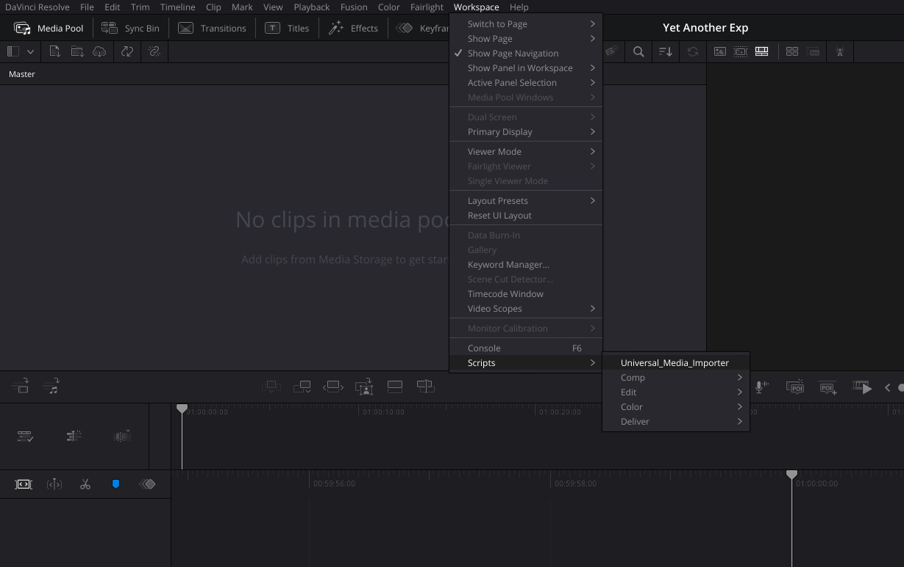
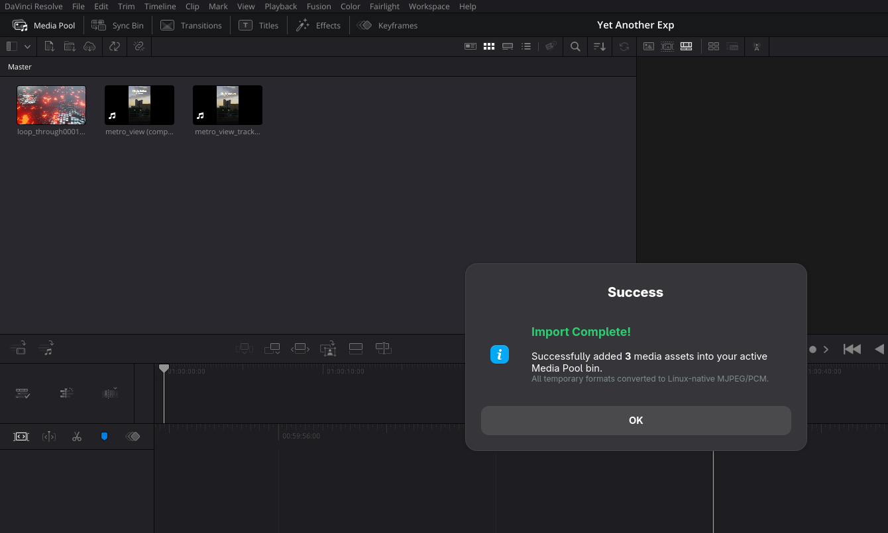
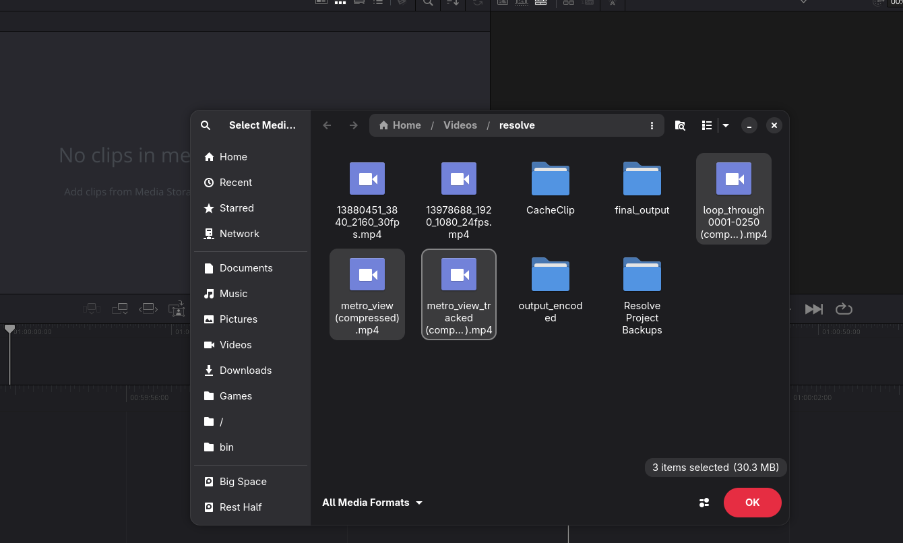
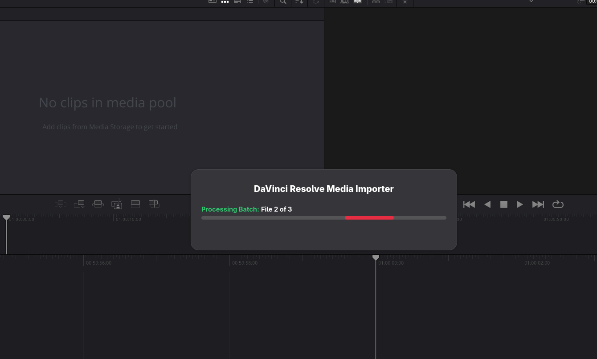
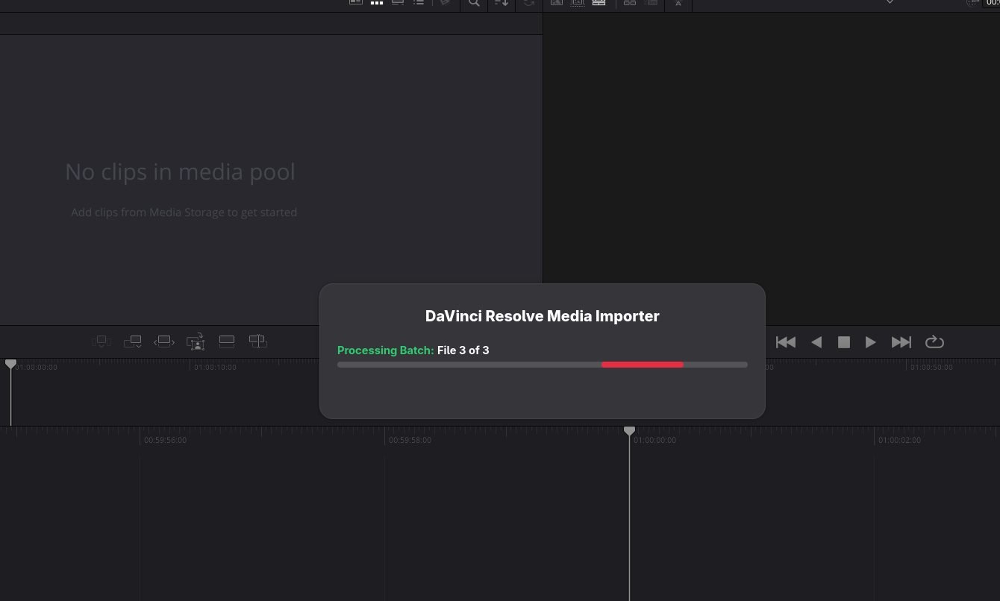
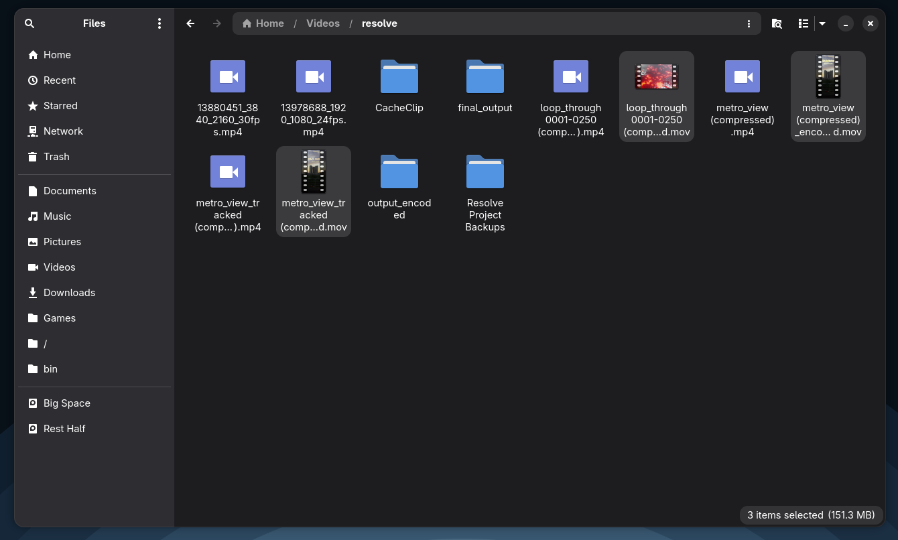

# DaVinci Resolve Linux Media Importer & Transcoder

A lightweight, seamless Python automation script for **DaVinci Resolve (Free Version) on Linux** (tested on Fedora). It enables one-click transcoding and direct importing of common audio and video formats (H.264/MP4, MKV, MP3, AAC, WEBM, etc.) into your active DaVinci Resolve Media Pool using FFmpeg and native Zenity GTK dialogs.

---

## Why This Exists

The free edition of DaVinci Resolve on Linux has well-known codec limitations due to licensing restrictions (specifically missing native support for AAC audio decoding and proprietary H.264/H.265 in MP4 containers). 

This script solves the problem by:
1. Providing a graphical file picker (`zenity`) to select single or batch media files.
2. Transcoding audio/video in the background via `ffmpeg` into DaVinci Resolve Linux-compatible native formats:
   - **Video**: MJPEG (`-vcodec mjpeg -q:v 2`) + Uncompressed 16-bit Big-Endian PCM Audio (`-acodec pcm_s16be`) in a `.mov` container.
   - **Audio**: Uncompressed 16-bit Big-Endian PCM Audio (`-acodec pcm_s16be`) in a `.mov` container.
3. Automatically injecting the transcoded clips straight into your open DaVinci Resolve project's Media Pool via DaVinci Resolve's Python Scripting API.

## See It in Action

<table>
   <tr>
      <td></td>
      <td></td>
   </tr>
   <tr>
      <td align="center"><em>Launch the importer from Resolve's Workspace menu.</em></td>
      <td align="center"><em>Imported media appears in the Media Pool after processing.</em></td>
   </tr>
</table>

---

## Prerequisites

Ensure the following tools are installed on your Linux system:

### 1. Python 3
DaVinci Resolve requires Python 3 for scripting integration.

### 2. FFmpeg
Used for background audio and video transcoding.

### 3. Zenity
Used for GTK-based file selection dialogs and progress bars.

---

## Installation & Setup (Fedora Linux)

### Step 1: Install Dependencies

On **Fedora**, install `ffmpeg`, `zenity`, and `python3`:

```bash
# Enable RPM Fusion (required for full FFmpeg) if not already enabled:
sudo dnf install -y https://mirrors.rpmfusion.org/free/fedora/rpmfusion-free-release-$(rpm -E %fedora).noarch.rpm https://mirrors.rpmfusion.org/nonfree/fedora/rpmfusion-nonfree-release-$(rpm -E %fedora).noarch.rpm

# Install packages:
sudo dnf install -y ffmpeg zenity python3
```

> **Note for other distributions:**
> - **Ubuntu/Debian:** `sudo apt install ffmpeg zenity python3`
> - **Arch Linux:** `sudo pacman -S ffmpeg zenity python`

---

### Step 2: Install the Script into DaVinci Resolve

DaVinci Resolve loads user Utility scripts from the Fusion scripts directory.

Copy your script (`Universal_Media_Importer.py`) into the **Utility** scripts directory:

```bash
# Create the Utility directory if it does not exist:
mkdir -p "$HOME/.local/share/DaVinciResolve/Fusion/Scripts/Utility"

# Copy the script:
cp Universal_Media_Importer.py "$HOME/.local/share/DaVinciResolve/Fusion/Scripts/Utility/"

# Make sure the script has execute permissions:
chmod +x "$HOME/.local/share/DaVinciResolve/Fusion/Scripts/Utility/Universal_Media_Importer.py"
```

Or download the latest version directly from GitHub with `curl`:

```bash
mkdir -p "$HOME/.local/share/DaVinciResolve/Fusion/Scripts/Utility"
curl -fL "https://raw.githubusercontent.com/tl2a/Davinci-universal-media-importer/refs/heads/main/Universal_Media_Importer.py" \
   -o "$HOME/.local/share/DaVinciResolve/Fusion/Scripts/Utility/Universal_Media_Importer.py"
chmod +x "$HOME/.local/share/DaVinciResolve/Fusion/Scripts/Utility/Universal_Media_Importer.py"
```

Or with `wget`:

```bash
mkdir -p "$HOME/.local/share/DaVinciResolve/Fusion/Scripts/Utility"
wget -O "$HOME/.local/share/DaVinciResolve/Fusion/Scripts/Utility/Universal_Media_Importer.py" \
   "https://raw.githubusercontent.com/tl2a/Davinci-universal-media-importer/refs/heads/main/Universal_Media_Importer.py"
chmod +x "$HOME/.local/share/DaVinciResolve/Fusion/Scripts/Utility/Universal_Media_Importer.py"
```

*Or system-wide for all users:*
```bash
sudo cp Universal_Media_Importer.py /opt/resolve/Fusion/Scripts/Utility/
```

---

## How to Use

1. Launch **DaVinci Resolve** and open your project.
2. In the top menu bar, navigate to:
   ```
   Workspace -> Scripts -> Universal_Media_Importer
   ```
3. A GTK file picker will open. Select one or multiple media files (`.mp4`, `.mkv`, `.mp3`, `.mov`, `.webm`, `.flv`, `.m4a`, `.wav`, `.ogg`, `.aac`, `.flac`).
4. A progress window will display the batch encoding status.
5. Once completed, the transcoded files (`*_encoded.mov`) will be automatically imported into your active Media Pool bin ready for editing.

### Visual Walkthrough

<table>
   <tr>
      <td><br><em>Open the importer from Workspace &gt; Scripts.</em></td>
      <td><br><em>Select one or more media files.</em></td>
   </tr>
   <tr>
      <td><br><em>The importer processes the selected batch.</em></td>
      <td><br><em>Progress updates as each file is transcoded.</em></td>
   </tr>
   <tr>
      <td><br><em>The imported media appears in the Media Pool as the confirmation modal appears.</em></td>
      <td><br><em>Converted `.mov` files are available alongside the source media.</em></td>
   </tr>
</table>

---

## Output Format Details

| Source Type | Container | Video Codec | Audio Codec |
| :--- | :--- | :--- | :--- |
| **Video Files** (`.mp4`, `.mkv`, `.webm`, etc.) | QuickTime (`.mov`) | Motion JPEG (`mjpeg`, `-q:v 2`) | Uncompressed PCM (`pcm_s16be`) |
| **Audio Files** (`.mp3`, `.m4a`, `.aac`, `.ogg`, etc.) | QuickTime (`.mov`) | *None* (`-vn`) | Uncompressed PCM (`pcm_s16be`) |

---

## Troubleshooting

- **"Please open a project first!"**: Ensure you have an active project loaded in DaVinci Resolve before executing the script.
- **Python Scripting not working inside Resolve**: In DaVinci Resolve, go to `Preferences -> General` and ensure external scripting is set to `Local` or `Network`. Ensure your system's Python 3 path is recognized by Resolve.
- **Zenity window not appearing**: Verify `zenity` is installed by running `zenity --version` in your terminal.
- **FFmpeg errors**: Verify `ffmpeg` is properly installed with support for common decoders by running `ffmpeg -version`.

---

## License

This project is licensed under the **GNU General Public License v3.0 (GPL-3.0)**.

```
Copyright (C) 2026 Arpan

This program is free software: you can redistribute it and/or modify
it under the terms of the GNU General Public License as published by
the Free Software Foundation, either version 3 of the License, or
(at your option) any later version.

This program is distributed in the hope that it will be useful,
but WITHOUT ANY WARRANTY; without even the implied warranty of
MERCHANTABILITY or FITNESS FOR A PARTICULAR PURPOSE.  See the
GNU General Public License for more details.

You should have received a copy of the GNU General Public License
along with this program.  If not, see <https://www.gnu.org/licenses/>.
```